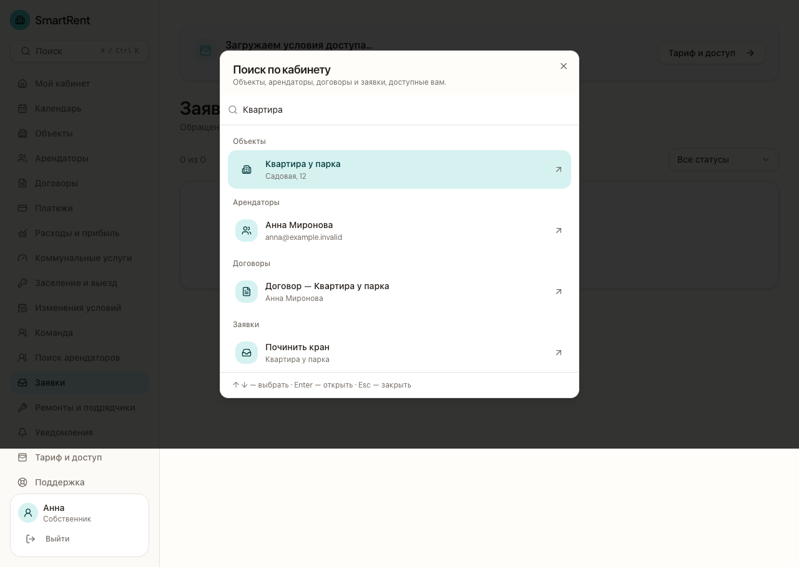

<p align="center">
  
</p>

<h1 align="center">SmartRent</h1>

<p align="center">
  <strong>Управляйте арендой из одного кабинета</strong>
</p>

<p align="center">
  <a href="https://mysmartrent.lovable.app/"><strong>Открыть SmartRent</strong></a> ·
  <a href="#возможности">Возможности</a>
</p>

**SmartRent** связывает недвижимость, арендаторов, договоры, платежи и заявки. По каждому объекту собственник может увидеть, когда заканчивается договор, сколько денег поступило и какие обращения ещё в работе. Арендатор в своём кабинете может открыть договор, отправить заявку с фото и следить за её статусом.

<p align="center">
  
</p>

<p align="center"><sub>Кабинет собственника. Поиск по объектам, договорам и заявкам на тестовых данных.</sub></p>

## Возможности

| Раздел | Что можно делать |
| --- | --- |
| Объекты и договоры | Добавить квартиру, склад или коммерческое помещение, пригласить арендатора и прикрепить PDF договора |
| Финансы | Сверить начисления с поступлениями, учесть расходы и сравнить плановый и фактический результат по объектам |
| Заявки | Получить обращение с фото, обсудить его с арендатором и обновить статус |
| Календарь и поиск | Проверить предстоящие события по аренде и быстро найти нужный объект, арендатора, договор или заявку |

[Посмотреть экран «Расходы и прибыль»](./docs/evidence/2026-10-30/finances-owner.png) · [Мобильная версия](./docs/evidence/2026-10-30/finances-owner-mobile.png)

## Стек

- **Приложение** · TypeScript, React, TanStack Start, Tailwind CSS
- **Данные и доступ** · Supabase Auth, PostgreSQL с Row Level Security (RLS), Supabase Storage
- **Проверки** · Node.js test runner, pgTAP, Playwright, GitHub Actions

## Документация

- [Руководство пользователя](./docs/user-guide.md) и [сценарий демонстрации](./docs/grant-demo-script.md)
- [Исходное ТЗ](./docs/mvp-brief.md) и [план развития](./docs/product-roadmap.md)
- [Модель монетизации](./docs/monetization.md) и [порядок запуска тарифов](./docs/billing-access.md). До явного запуска администратором все возможности бесплатны, ограничения отключены.

<details>
<summary>Локальная разработка и развёртывание</summary>

### Локальный запуск

Понадобятся Node.js 22+, Bun и Supabase с применёнными миграциями из `supabase/migrations/`.

1. Из корня репозитория установите зависимости командой `bun install --frozen-lockfile`.
2. Укажите в `.env` адрес проекта в `VITE_SUPABASE_URL` и `SUPABASE_URL`, а публичный ключ в `VITE_SUPABASE_PUBLISHABLE_KEY` и `SUPABASE_PUBLISHABLE_KEY`.
3. Запустите `bun run dev` и откройте адрес, который выведет Vite.

### Проверки

Быстрые тесты бизнес-логики, TypeScript, ESLint и production-сборка:

```sh
npm run verify
```

Полный сценарий аренды и RLS проверяется pgTAP-тестом
`supabase/tests/core_rental_workflow_test.sql`. Он создаёт собственника,
объект, помещение, приглашённого арендатора, договор, заявку, комментарий и
уведомления внутри транзакции, после чего полностью откатывает тестовые данные.

Для запуска нужны Supabase CLI, локальный Supabase и Docker-совместимый
container runtime:

```sh
supabase start
npm run test:db
```

Не запускайте database-тесты с `--linked` против production-проекта. Для CI
используйте локальный Supabase или отдельный тестовый проект.

Быстрый браузерный smoke-тест проверяет лендинг, форму регистрации и защиту
закрытых страниц. Он не создаёт пользователей и не изменяет данные:

```sh
npm run test:e2e
```

Полный E2E-сценарий создаёт уникальные локальные аккаунты собственника и
арендатора, проверяет сохранение сессии, ролевые переходы и выход. Команда сама
берёт адрес и публичный ключ из запущенного локального Supabase и блокирует
подключение к удалённой базе:

```sh
supabase start
npm run test:e2e:local
```

Для браузерных тестов требуется установленный Google Chrome.

GitHub Actions повторяет `verify`, database-тесты и полный E2E-сценарий при
каждом push в `main` и для каждого pull request. Интеграционные тесты поднимают
одноразовый локальный Supabase внутри GitHub Runner и не требуют production
секретов.

### Деплой миграций Supabase

Workflow `.github/workflows/deploy-supabase.yml` применяет миграции к production
только из `main`. Перед первым запуском создайте GitHub Environment `production`
и добавьте в него secrets:

- `SUPABASE_ACCESS_TOKEN` — personal access token Supabase;
- `SUPABASE_DB_PASSWORD` — пароль production-базы.

Также добавьте repository variables:

- `SUPABASE_PRODUCTION_PROJECT_ID` — ref production-проекта (для текущего проекта
  `euuyvfidarhpeqeeheuu`);
- `SUPABASE_PRODUCTION_DEPLOY_ENABLED` — установите `true` только после успешной
  первой синхронизации.

Первую синхронизацию запускайте вручную через GitHub Actions →
`Deploy Supabase migrations` → `Run workflow`. Workflow сначала выполняет
`db push --dry-run`, затем применяет только ожидающие миграции без seed-данных и
показывает итоговый список версий.

Если первая проверка сообщает о расхождении истории, не применяйте
`migration repair` вслепую. Сначала сравните локальный и удалённый список через
`supabase migration list --linked` и фактическую схему production. После успешной
ручной синхронизации включите `SUPABASE_PRODUCTION_DEPLOY_ENABLED=true`: новые
миграции будут применяться автоматически после успешного CI для push в `main`.

Для дополнительной защиты включите required reviewers у GitHub Environment
`production`. Workflow не отменяет уже начавшийся deploy при появлении нового
коммита и никогда не выполняет удалённый `db reset`.

Используйте только один механизм production-деплоя. Если в Supabase GitHub
Integration уже включён `Deploy to production`, не включайте
`SUPABASE_PRODUCTION_DEPLOY_ENABLED` для этого workflow, чтобы два процесса не
применяли миграции одновременно.

</details>

Проект создан с помощью [Lovable](https://lovable.dev). Изменения в связанной ветке `main` синхронизируются с [редактором проекта](https://lovable.dev/projects/5ba9fbac-dbf5-4af0-a8d6-212be58185b6).
